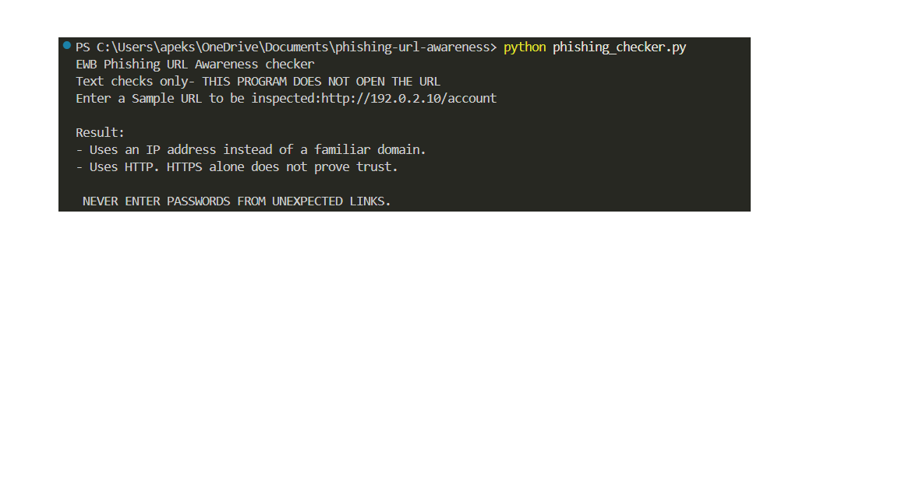
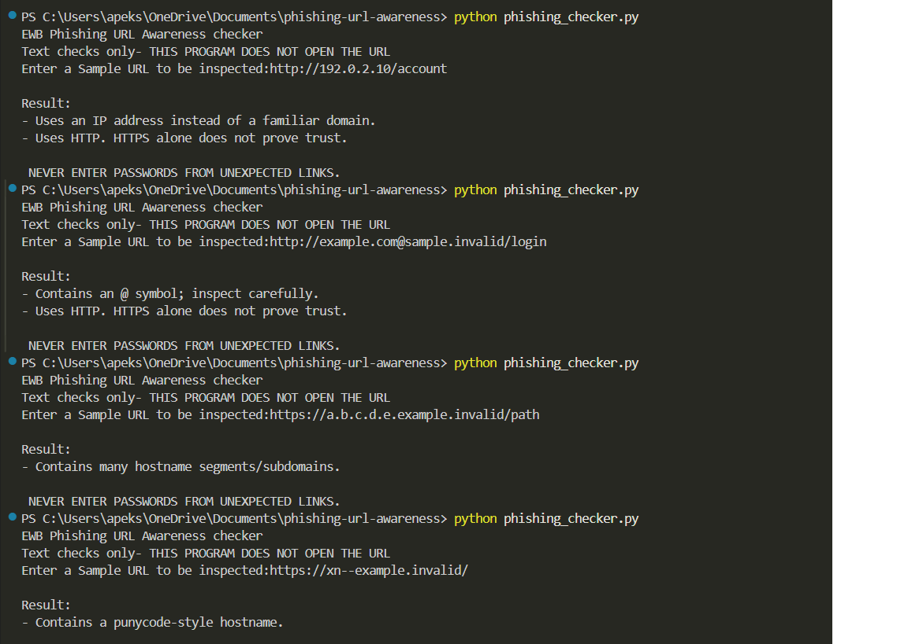

# EWB Phishing URL Awareness Checker

## Overview
Phishing is a deceptive technique where attackers use fake links or messages to trick individuals into revealing sensitive information such as passwords, card numbers, or OTPs. This tool is an educational Python command-line utility designed to inspect the visible text of a URL for common phishing warning signs without ever visiting websites, making network requests, or connecting to remote servers.

## Features
- Detects an @ symbol in the URL
- Flags unusually long URLs (over 100 characters)
- Flags IP-address hostnames
- Flags many hostname segments (5 or more)
- Flags punycode-style hostnames (xn--)
- Flags the HTTP scheme
- Continuous Execution Loop: Check multiple URLs sequentially without restarting the script, with a dedicated exit command (`q`, `quit`, or `exit`)
- Dynamic Warning Counter: Automatically aggregates findings and prints a clear "Review Carefully" summary banner with the exact count of warning signs detected
- Malformed Input Guard: Prevents runtime crashes when encountering malformed or invalid URL syntax using structured error handling

## Requirements
Python 3.10 or later. No extra packages.

## How to Run
Windows: `python phishing_checker.py`  
Mac/Linux: `python3 phishing_checker.py`

## Example Output
```text
EWB Phishing URL Awareness Checker
Text checks only - this program does not open URLs.

Enter a sample URL (or type q to quit): http://192.0.2.10/account

Result:
- Uses an IP address instead of a familiar domain.
- Uses HTTP. HTTPS alone does not prove trust.

REVIEW CAREFULLY: 2 warning sign(s) found.
Never enter passwords from unexpected links.

Enter a sample URL (or type q to quit): q
Goodbye! Stay alert online.
```

## Testing

| # | Input | Expected Result | Actual Result | Pass/Fail |
|---|---|---|---|---|
| 1 | `https://www.example.com/login` | No warning signs | No listed warning signs found. THIS DOESNOT PROVE SAFETY. | PASS |
| 2 | `http://192.0.2.10/account` | IP address + HTTP | Uses an IP address instead of a familiar domain. <br> Uses HTTP. HTTPS alone does not prove trust. | PASS |
| 3 | `http://example.com@sample.invalid/login` | @ symbol + HTTP | Contains an @ symbol; inspect carefully. <br> Uses HTTP. HTTPS alone does not prove trust. | PASS |
| 4 | `https://a.b.c.d.e.example.invalid/path` | Many hostname segments | Contains many hostname segments/subdomains. | PASS |
| 5 | `https://xn--example.invalid/` | Punycode-style hostname | Contains a punycode-style hostname. | PASS |

## Screenshots
  
 & ()

## Improvements
1. **Option A: Interactive Execution Loop (`while True`)** - Replaced single-run execution with a continuous loop allowing multiple URL checks and a clean exit via `q`, `quit`, or `exit`. Tested by running consecutive input strings and verifying successful termination.
2. **Option B: Dynamic Warning Counter Summary (`has_warnings`)** - Added a helper function to evaluate findings and output a quantified risk warning count (`REVIEW CAREFULLY: X warning sign(s) found`). Tested using known samples to ensure accurate warning aggregation.
3. **Option C: Malformed Input Exception Handling** - Wrapped URL parsing in a `try...except ValueError` block to catch malformed host inputs (such as bracketed IPv6 strings) without crashing the program. Tested using malformed test inputs.

## Limitations
This is an educational tool. It only reads URL text. It does not visit URLs, scan for malware or prove that a URL is safe. No warning signs found does NOT mean a URL is safe.

## Ethical Use
Use sample strings only. Do not collect credentials. Do not use this project to deceive anyone or to test websites without permission.

## Author
Apekshit, B.Tech Undergraduate (IIT Kharagpur), EWB Courses